

  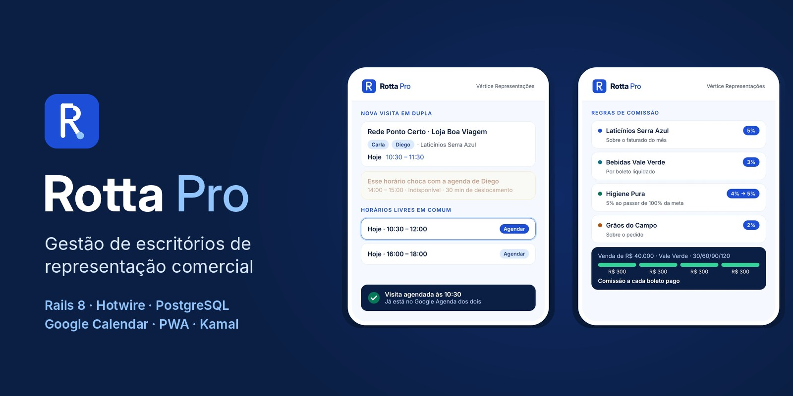

<h1 align="center">Rotta Pro</h1>

  <b>App de gestão para escritórios de representação comercial, em produção.</b> 
  Agenda da equipe com Google Agenda, visitas em dupla sem conflito, funil de vendas, demandas, vendas, metas e comissões por indústria.

  <a href="https://rottapro.site"><b>rottapro.site</b></a> ·
  <a href="#desafios-técnicos">Desafios técnicos</a> ·
  <a href="#arquitetura">Arquitetura</a> ·
  <a href="#english-summary">English summary</a>

  
  
  
  
  
  
  

> O código-fonte é privado, porque o Rotta Pro é um produto comercializado. Este repositório reúne o estudo de caso, a arquitetura e as decisões técnicas. **O código está disponível para avaliação técnica mediante solicitação**, em entrevista ou com acesso temporário ao repositório.

---

## O problema

Escritórios de representação comercial vendem para várias indústrias ao mesmo tempo, com representantes na rua, promotores fazendo ações nas lojas e gerentes das indústrias acompanhando os resultados. No dia a dia, isso costuma viver em planilhas, grupos de WhatsApp e agendas soltas:

- dois representantes que visitam clientes **em dupla** não sabem quando o outro está livre;
- **compromissos pessoais** precisam bloquear a agenda sem expor o que são;
- cada indústria paga **comissão com uma regra diferente** (sobre o pedido, sobre o faturado do mês ou sobre o boleto pago, parcela a parcela);
- ninguém sabe ao certo **quanto vai receber no mês seguinte**.

## A solução

Um app web instalável no celular (PWA) que organiza a operação do escritório inteiro:

| Agenda e equipe | Vendas e comissões |
|---|---|
| 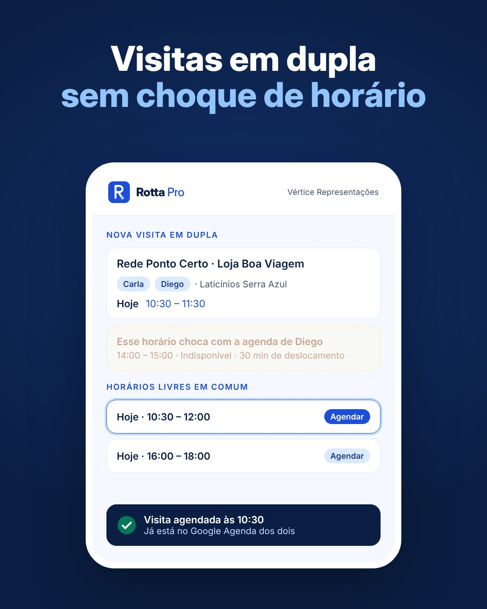 | 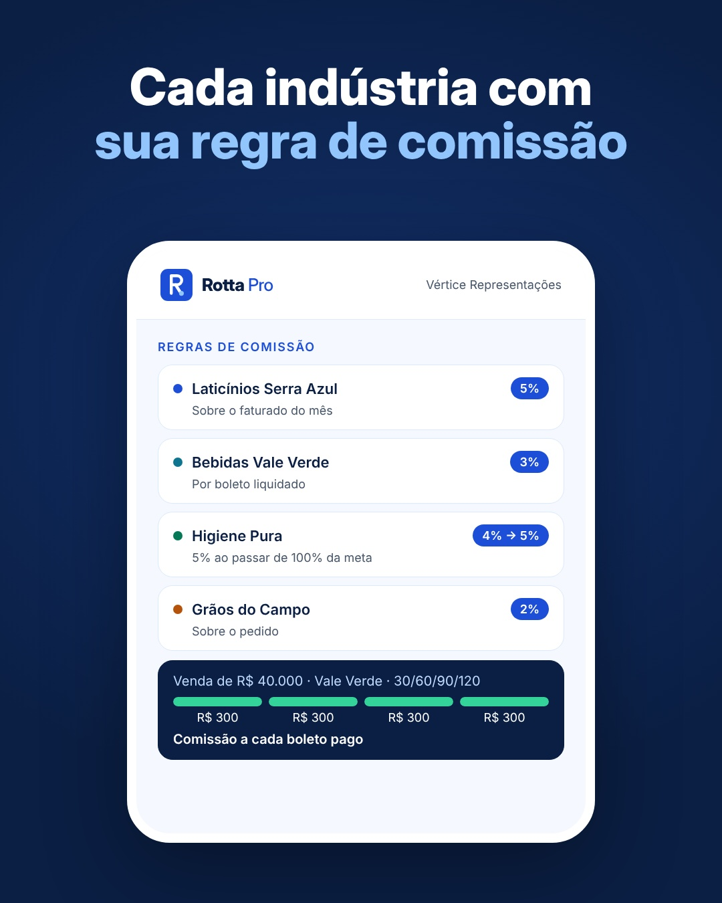 |
| Agenda compartilhada, sincronizada com o Google Agenda de cada pessoa. Ao marcar uma visita em dupla, o app avisa conflitos e sugere horários livres em comum. | Regras de comissão por indústria, parcelas de boleto, metas e projeção do que cai no mês seguinte. |

| Funil de vendas | Projeção de comissões |
|---|---|
| 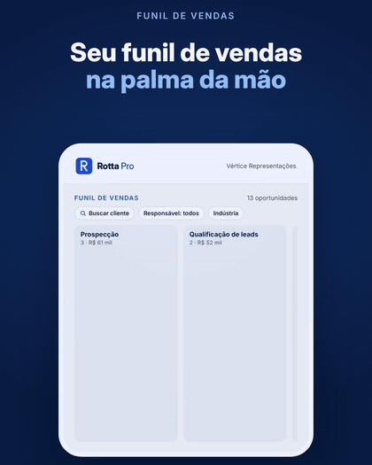 | 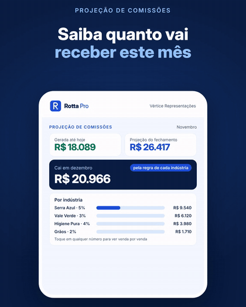 |
| Kanban com arrastar e soltar (inclusive no celular: tocar, segurar e arrastar). | Comissão gerada no mês, projeção do fechamento e receita futura por indústria e representante. |

**Principais funcionalidades**

- **Agenda da equipe** integrada ao Google Agenda (OAuth), com dia, semana, quinzena e mês
- **Visitas em dupla** com detecção de conflito, tempo de deslocamento e horários livres em comum
- **Privacidade**: compromisso pessoal aparece para os outros só como "Indisponível" (ou com uma nota escolhida)
- **Perfis e permissões**: administrador, coordenador, representante, promotor e gerente de indústria, cada um vendo só o que deve
- **Situação dos compromissos** (concluído, adiado, remarcado, cancelado) com um toque
- **Demandas** com responsável, prazo, filtros e indicadores de atraso
- **Funil de vendas** em Kanban, com histórico de fases e "registrar venda" a partir da oportunidade
- **Vendas, metas e comissões**: realizadas, faturadas e em carteira; atingimento de meta; projeção de comissões
- **Importação de clientes por planilha** (Excel e CSV) com mapeamento de colunas e sem duplicar clientes
- **Resumo do dia**, gráficos de desempenho e números clicáveis até a venda
- **Multiempresa (multi-tenant)** com cadastro controlado pelo super administrador, planos e e-mails transacionais
- **Modo escuro**, instalação como app e identidade visual própria

## Números do projeto

| | |
|---|---|
| Requisitos especificados e rastreados | **290+** (RF-01 a RF-297) |
| Testes automatizados (Minitest) | **650+** |
| Pull requests mesclados, com CI | **50+** |
| Em produção desde | **2026** |

## Stack

| Camada | Tecnologia | Por quê |
|---|---|---|
| Back-end | **Ruby on Rails 8.1**, Ruby 3.4 | Produtividade alta para um time de uma pessoa, convenções fortes e um ecossistema maduro |
| Front-end | **Hotwire** (Turbo + Stimulus), Tailwind CSS, importmap | Interface rápida e reativa sem manter uma SPA separada nem um build de JavaScript |
| Banco de dados | **PostgreSQL** | Integridade, índices para busca sem acento e consultas agregadas de vendas |
| Filas, cache e WebSocket | **Solid Queue**, Solid Cache, Solid Cable | Tudo no próprio PostgreSQL, sem Redis, o que simplifica a infraestrutura |
| Integrações | **Google OAuth** + **Google Calendar API**, Resend (e-mail) | Login com Google, compromissos enviados ao Google Agenda de cada pessoa e importação dos horários ocupados |
| Segurança | Active Record Encryption, CSRF, Brakeman | Tokens do Google criptografados no banco e análise estática em todo PR |
| Infraestrutura | **Kamal 2**, Docker, VPS Ubuntu, Let's Encrypt, Cloudflare R2 | Deploy com um comando, HTTPS automático e backups criptografados fora do servidor |
| Qualidade | Minitest, GitHub Actions (testes, RuboCop, Brakeman, importmap audit), Dependabot | Nenhum código entra na main sem CI verde |
| Mobile | **PWA** | Instalável no Android, iPhone e computador, sem loja de apps |

## Desafios técnicos

### 1. Multi-tenant sem vazamento de dados
Cada escritório é isolado: toda consulta parte do escritório atual (`current_office`), e os testes verificam que nenhum dado de outro escritório aparece em listas, somas, buscas ou detalhamentos. Um mesmo usuário pode ter vários papéis no mesmo escritório, e regras de negócio garantem que sempre exista ao menos um administrador e um representante ativos.

### 2. Agenda compartilhada com privacidade
O núcleo da agenda é um conjunto de **serviços em Ruby puro, sem dependência do Rails**, cobertos por testes unitários:

- `Agenda::Interval`: intervalos de tempo com sobreposição e margem de deslocamento
- `Agenda::ConflictChecker`: encontra conflitos entre os participantes de uma visita
- `Agenda::CommonSlotFinder`: sugere horários livres em comum para visitas em dupla
- `Agenda::VisibilityPolicy`: decide o que cada perfil pode ver de cada compromisso (detalhes completos, "Indisponível" ou "Ocupado")

### 3. Integração com o Google Agenda
Login com Google para identidade e um segundo fluxo OAuth com escopos mínimos (`calendar.app.created` e `calendar.freebusy`) para a agenda. Os tokens de atualização ficam criptografados no banco. A sincronização roda em jobs em segundo plano (criar, atualizar e apagar eventos, e importar os horários ocupados), para que a interface nunca espere a API do Google.

### 4. Regras de comissão por indústria
Cada indústria pode pagar sobre o **pedido**, sobre o **faturado do mês** ou sobre o **boleto liquidado**, parcela a parcela (30/60/90...). Cada regra tem início de vigência: mudar a comissão cria uma regra nova, e as vendas antigas continuam calculadas pela regra delas. O cálculo da comissão é Ruby puro, e a projeção do mês e do mês seguinte reaproveita esse mesmo cálculo. As somas de vendas **realizadas, faturadas e em carteira** ficam centralizadas num só lugar, e metas, gráficos, resumo do dia e relatórios reaproveitam essa mesma regra, sem duplicar cálculo.

### 5. Deploy próprio e backups
O app roda numa VPS própria com **Kamal 2**, dividindo o mesmo `kamal-proxy` com outro sistema em produção sem derrubá-lo. HTTPS via Let's Encrypt, banco PostgreSQL como acessório e **backup diário criptografado (GPG)**, mantido 7 dias no servidor e 30 dias no Cloudflare R2. Deploy só a partir da `main`, depois de CI verde, com backup antes de cada deploy.

### 6. Login com Google dentro do app instalado (PWA)
No Android, o login pelo app instalado falhava, enquanto pelo navegador funcionava. A investigação nos logs de produção mostrou que o navegador entregava o retorno do Google duas vezes: a primeira fazia o login, e a segunda, recusada pelo Google, gravava por cima uma sessão sem usuário. A correção reconhece essa repetição uma única vez e por poucos minutos, só depois de a verificação de segurança do OAuth já ter conferido a tentativa, e mantém a pessoa logada, sem afetar o login pelo navegador nem a conexão com o Google Agenda.

### 7. Importação de planilhas das indústrias
Cada indústria exporta clientes num formato diferente. A importação sugere o mapeamento das colunas pelo nome (com variações como "Razão social", "CPF/CNPJ", "Fone"), guarda o mapeamento por indústria, mostra uma pré-visualização e **nunca duplica um cliente**: identifica pelo CNPJ (ou pelo nome, quando não há CNPJ) e só completa campos vazios.

## Arquitetura

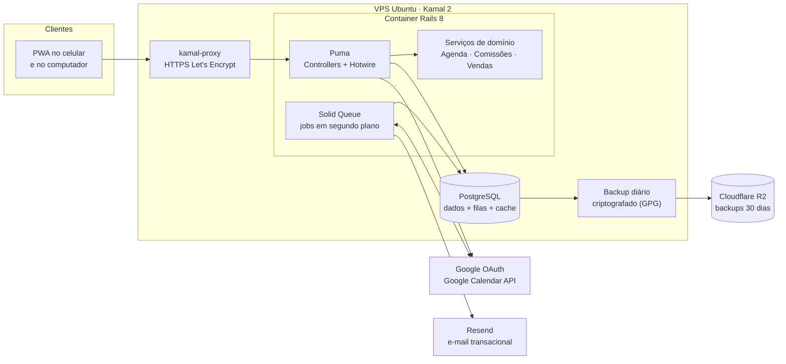

**Fluxo de trabalho**

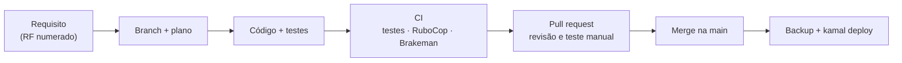

## Galeria

| | | |
|---|---|---|
| 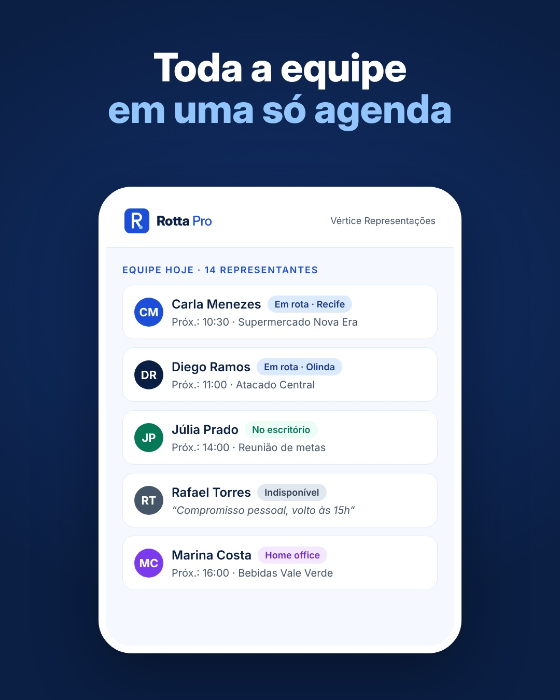 | 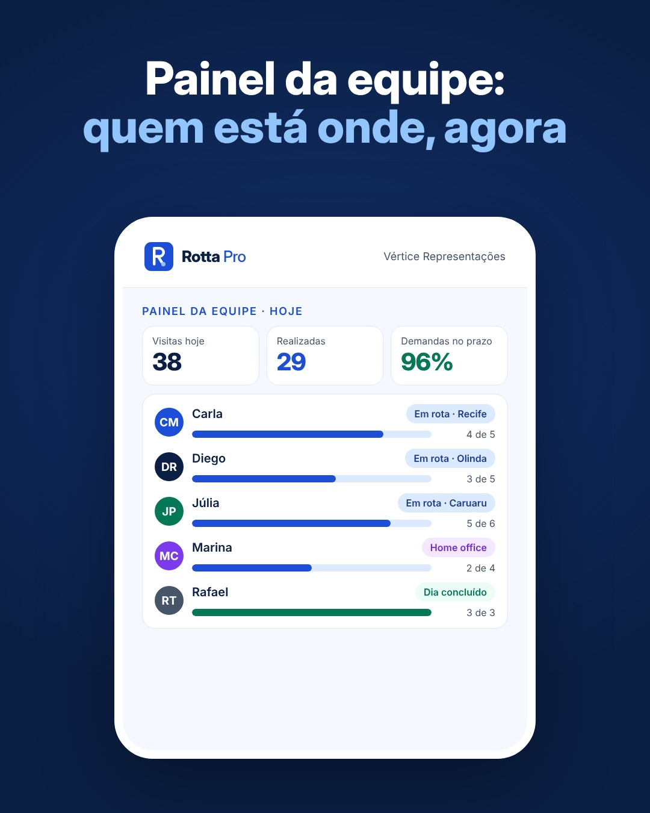 | 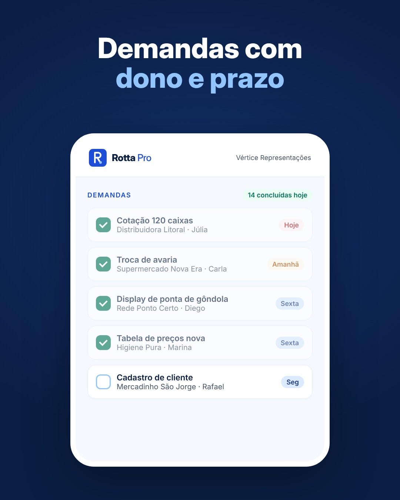 |
| 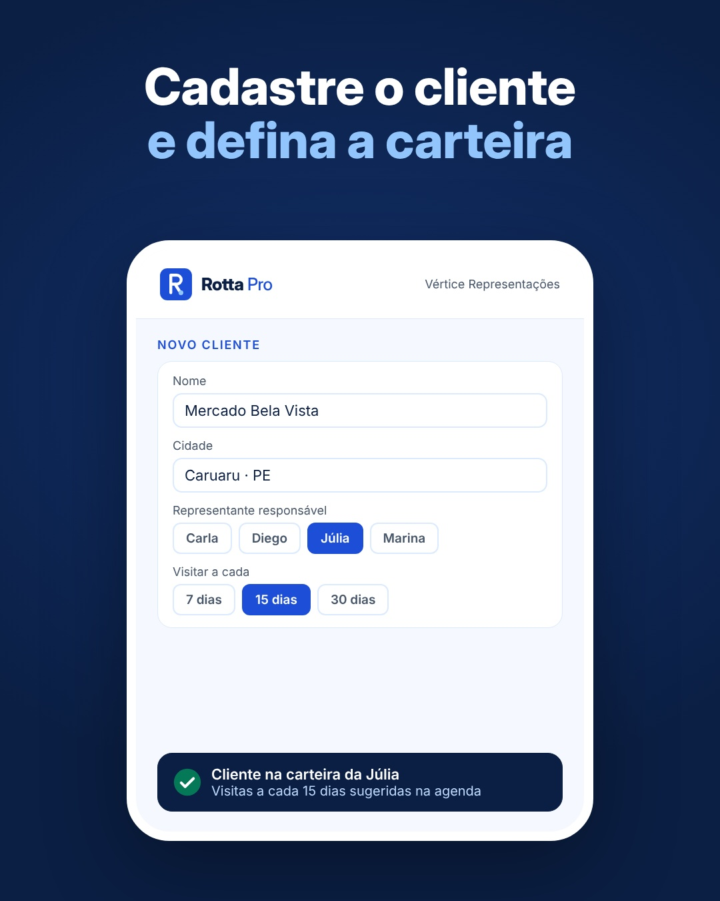 | 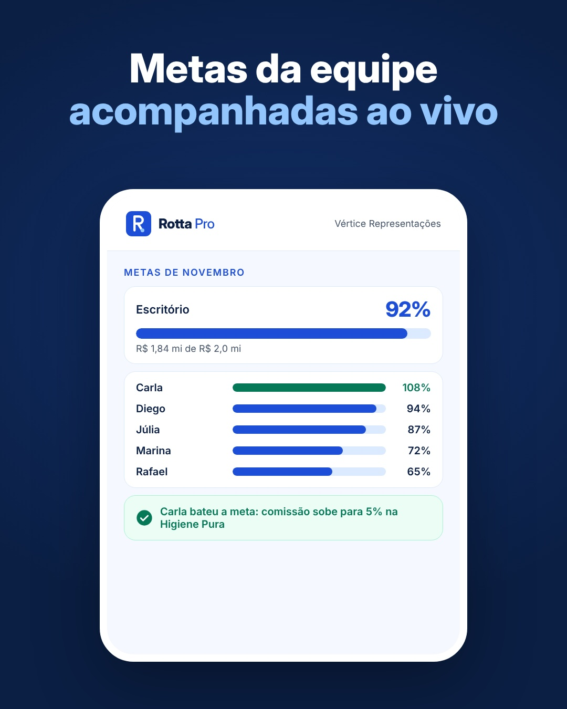 | 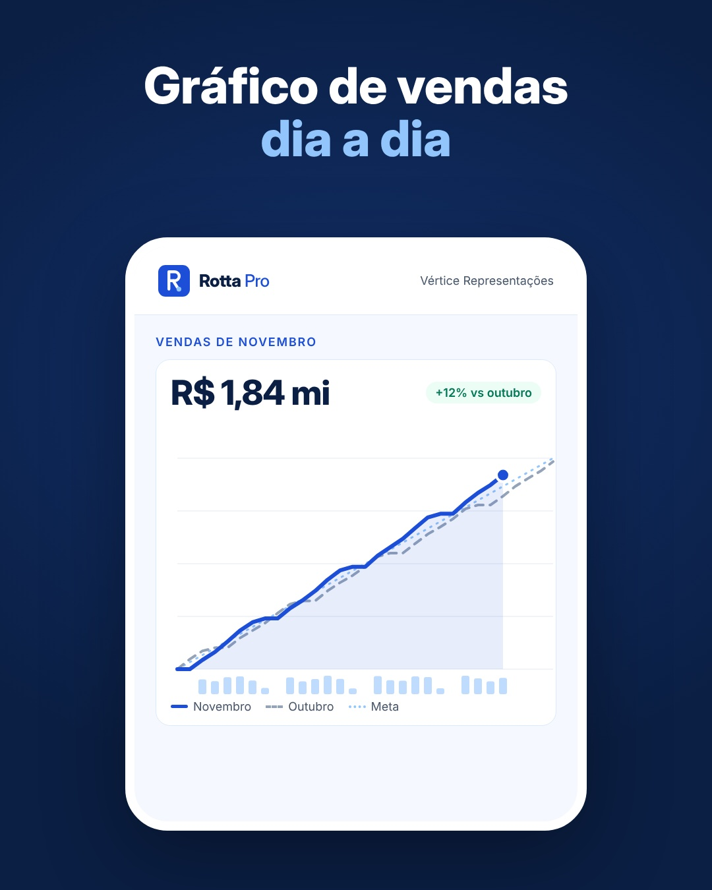 |

Ilustrações das telas, com dados fictícios.

## Meu papel

Fiz o projeto de ponta a ponta:

- **Produto:** entrevistas com o primeiro cliente, levantamento e priorização de mais de 290 requisitos, definição do MVP e das fases
- **Desenvolvimento:** modelagem de dados, back-end, front-end, testes e integrações
- **Infraestrutura:** servidor, domínio, DNS, deploy, HTTPS, e-mail transacional e backups
- **Design:** identidade visual, logo, ícone do app e interface
- **Negócio:** modelo de assinatura, página de vendas e materiais de divulgação

**Sobre o uso de IA:** desenvolvi o Rotta Pro com apoio do **Claude Code**, um assistente de programação com IA. Eu escrevi as especificações, planejei cada entrega, revisei o código, testei cada mudança no navegador e mantenho o sistema em produção. Trabalhar assim me ensinou a decompor problemas em entregas pequenas e verificáveis, a escrever requisitos sem ambiguidade e a não aceitar código que eu não consigo explicar.

## Sobre mim

Sou estudante de **Análise e Desenvolvimento de Sistemas** e venho do mercado de **representação comercial**. O Rotta Pro nasceu de uma dor que eu conheço por dentro e já roda em produção no primeiro escritório cliente. Estou em transição de carreira para desenvolvimento de software e busco oportunidades como desenvolvedor.

- LinkedIn: [linkedin.com/in/edivaniofilho](https://www.linkedin.com/in/edivaniofilho/)
- E-mail: [edivanio@uniquesellse.com](mailto:edivanio@uniquesellse.com)

---

## English summary

**Rotta Pro** is a production SaaS for sales representation offices (Brazil). It manages team calendars synced with Google Calendar, joint client visits with conflict detection and common free slots, private personal appointments, a Kanban sales pipeline, tasks, sales, goals and per-manufacturer commission rules (on order, on monthly invoicing or per paid installment, with effective dates), plus commission forecasting.

**Stack:** Ruby on Rails 8.1, Hotwire (Turbo + Stimulus), PostgreSQL, Tailwind, Solid Queue, Google OAuth + Calendar API, PWA, deployed with Kamal 2 on a self-managed VPS with encrypted off-site backups. 650+ automated tests, CI on every pull request.

**My role:** end to end: product discovery and 290+ tracked requirements, development, infrastructure, design and go-to-market. Built with the help of Claude Code (AI coding assistant): I wrote the specs, reviewed the code, tested every change and run the system in production.

The source code is private because Rotta Pro is a commercial product. Code walkthroughs and temporary repository access are available for technical evaluation on request.

---

© Rotta Pro. Todos os direitos reservados. Conteúdo exibido apenas para fins de portfólio.
